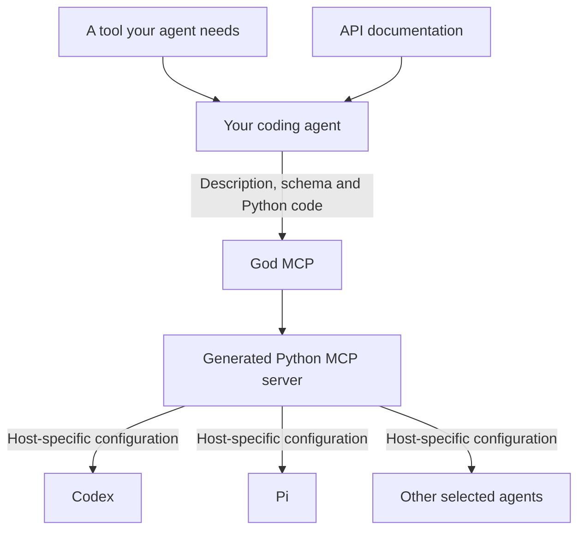
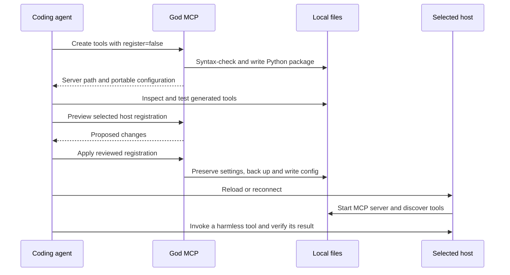

# God MCP

**An MCP server that lets your coding agent create the tools it needs.**

Missing an integration? Instead of finding a server, adapting it and configuring each agent by hand, ask your agent to build the tool. God MCP turns its implementation into a local Python MCP server and registers it with the agents you choose.

The agent does the API research and writes the tool logic. God MCP handles the server package and host configuration. You keep the generated source and choose where it runs.

[Quick start](#quick-start) · [How it works](#how-it-works) · [Agent adapters](#agent-adapters) · [Validation](VALIDATION.md)

## How it works



For example, once God MCP is connected:

> Build a read-only MCP tool for the API I linked. Read its official docs, use credentials from the environment, and generate the server without registering it yet. Test the tool, then preview installation for Codex and Pi.

The included [agent skill](skills/god-mcp/SKILL.md) guides this workflow: research, implement, generate, test and install. God MCP itself does not browse API documentation or run an embedded LLM.

### What it handles

- **Server generation:** tool descriptions, parameter schemas and Python bodies become a FastMCP package with an entry point, dependencies and a portable configuration descriptor.
- **Target selection:** choose the current agent, named agents, detected agents or all registered adapters. Generation is independent of the chosen model or provider.
- **Configuration:** preview changes, preserve unrelated settings, back up existing files and refuse conflicting entries unless replacement is explicit.
- **Iteration:** update generated tool implementations with syntax checking, then reconnect the host to load the changes.

## Quick start

Requires Python 3.10+, [uv](https://docs.astral.sh/uv/getting-started/installation/), and an MCP-capable agent. Keep the checkout at a stable path: the installed configuration points to it.

```sh
git clone https://github.com/Tarachand-Gupta/god-mcp.git
cd god-mcp
uv sync --locked
```

Choose the project where generated servers should live. Replace `/absolute/path/to/project` below with that directory.

```sh
# Inspect adapters and current-agent detection.
uv run god-mcp-config --workspace /absolute/path/to/project agents

# Preview installing God MCP in Codex's user configuration.
uv run god-mcp-config --workspace /absolute/path/to/project bootstrap --target codex --scope user

# Apply the same configuration after reviewing the preview.
uv run god-mcp-config --workspace /absolute/path/to/project bootstrap --target codex --scope user --apply
```

Use `--target pi` for Pi, or repeat `--target` to select multiple hosts. Use `--scope workspace` for project-local configuration when the adapter supports it. Bootstrap sets `GOD_MCP_AGENT` and `GOD_MCP_WORKSPACE` explicitly for each selected host; it does not install agent applications.

Reconnect or reload the agent, complete its project-trust or tool-approval flow if needed, and call God MCP's `health_check`. Optionally copy `skills/god-mcp/` into that agent's skill directory for the guided creation workflow.

**User-scope bootstrap still binds God MCP to the selected project directory.** To work in a different project, use a workspace registration or deliberately replace the user entry with `--replace` and the new workspace.

## From generated files to a working tool

Generation, configuration and activation are separate steps. A successful config write does not mean a running chat has loaded the new server.



### Create a small server

Call the `create_mcp_server` MCP tool with these arguments:

```json
{
  "name": "calculator",
  "description": "Add two integers",
  "tools": [
    {
      "name": "add",
      "description": "Add two integers",
      "parameters": {
        "type": "object",
        "properties": {
          "a": {"type": "integer"},
          "b": {"type": "integer"}
        },
        "required": ["a", "b"]
      },
      "implementation": "return {'result': a + b}"
    }
  ],
  "register": false
}
```

By default, this creates a directory under `.mcp-servers/` in the configured workspace:

```text
calculator/
├── pyproject.toml
├── README.md
├── mcp.json
└── src/calculator/
    ├── __init__.py
    └── server.py
```

The result includes `serverConfig`, a single portable server entry. After testing, pass it to `install_mcp_server` with the desired `targets`, `scope` and `dry_run: true`; use `dry_run: false` to apply. Alternatively, save just that entry as `server-entry.json` and use the CLI:

```sh
uv run god-mcp-config install calculator --config server-entry.json --target codex --target pi --scope user
uv run god-mcp-config install calculator --config server-entry.json --target codex --target pi --scope user --apply
```

The generated `mcp.json` contains a wrapper (`mcpServers`); the CLI's `--config` takes **one entry**, not the wrapped file. Packages stay local and are not published to PyPI. Existing server directories are never overwritten implicitly.

`create_mcp_server` also supports immediate registration with `register: true` (its default). Set `register: false` when you want to inspect and test first. Creation results report generation and registration separately.

## Agent adapters

MCP standardizes tool communication, not the configuration files each host uses. These adapters translate a common server entry into the host's configuration format.

| Agent ID | User configuration | Workspace configuration |
|---|---|---|
| `codex` | `$CODEX_HOME/config.toml` or `~/.codex/config.toml` | `.codex/config.toml` |
| `pi` | `~/.pi/agent/mcp.json` | `.pi/mcp.json` |
| `claude-code` | `~/.claude.json` | `.mcp.json` |
| `cursor` | `~/.cursor/mcp.json` | `.cursor/mcp.json` |
| `kiro` | `~/.kiro/settings/mcp.json` | `.kiro/settings/mcp.json` |
| `vscode` | Platform `Code/User/mcp.json` | `.vscode/mcp.json` |
| `windsurf` | `~/.codeium/windsurf/mcp_config.json` | Not supported |
| `claude-desktop` | Platform `Claude/claude_desktop_config.json` | Not supported |

`current` uses an explicit `GOD_MCP_AGENT` or unambiguous process signals. An installed binary is not evidence of the active host. `detected` checks configuration and command availability, which can miss GUI installations. Explicit targets do not require detection. `all` means all **registered adapters**, including undetected ones; unsupported scopes are reported per target. A failed target does not undo successful targets.

**Directly checked:** Codex 0.160.1 accepted generated configuration and discovered tools through its native app server. Pi 1.2.0 connected through its native MCP CLI, and its bundled MCP client invoked a generated calculator. The other adapters provide configuration support; they have not been verified in live hosts. See [validation evidence and limits](VALIDATION.md).

Pi can inspect connections with `pi mcp list`; use `/reload` in a running chat. Codex may require reconnecting or restarting the session. Host versions, trust settings and approval rules affect activation.

### Add an adapter

Set `GOD_MCP_AGENTS_FILE` to a JSON file like this:

```json
[
  {
    "id": "my-agent",
    "user_path": "~/.my-agent/mcp.json",
    "workspace_path": ".my-agent/mcp.json",
    "key": "mcpServers",
    "format": "json",
    "command": "my-agent",
    "note": "Reload the agent after installation."
  }
]
```

Formats are `json` and `toml`; `key` names a top-level mapping. Use `null` for unsupported workspace paths. Verify the host's actual schema first: nested structures or different entry formats need a code adapter. This does not add MCP support to an agent that lacks it.

## Boundaries and configuration behavior

- **Trusted local code:** generated implementations run with the launching user's privileges. God MCP is not a sandbox. Review the implementation and dependencies before execution.
- **Python generation:** packages use Python/FastMCP over MCP stdio. This version does not generate JavaScript or TypeScript servers.
- **Schema limits:** Python types are generated, but constraints such as patterns, enums and nested required fields are not fully translated. Implement those checks in the tool where needed.
- **Credentials:** use the launch environment or the host's supported authentication. Do not embed secrets in source. MCP config reads redact sensitive fields; private backups can still contain credentials.
- **Config writes:** preserve unrelated settings and TOML comments; use a lock, temporary file and change check before replacement. JSONC is not supported and is not rewritten. Conflicting entries require explicit replacement.
- **Legacy settings:** explicit `WORKSPACE_MCP_CONFIG_PATH` and `USER_MCP_CONFIG_PATH` remain supported. There is no implicit Kiro fallback. `remove_mcp_server` removes only the selected scope.

## Development

```sh
uv sync --locked --extra dev
uv run --locked pytest -q
uv run --locked ruff check src tests scripts
```

Tests cover configuration preservation, conflict handling, redaction and real MCP initialize/list/call exchanges using temporary files. The optional harness smoke check requires local Codex and Pi installations:

```sh
uv run --locked python scripts/smoke_harnesses.py
```

It uses isolated agent configuration and makes no model calls. See [CONTRIBUTING.md](CONTRIBUTING.md) for the code map and [VALIDATION.md](VALIDATION.md) for what has actually been exercised.

Built by [Tarachand Gupta](https://tarachand-gupta.github.io/). [MIT license](LICENSE).
